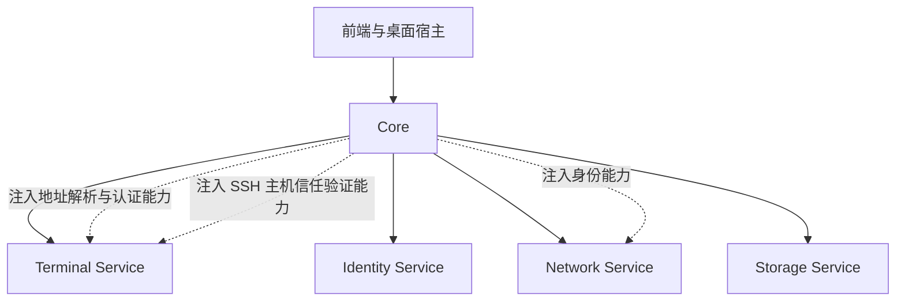

# Terminal Service 重构设计

本设计定义新的 Terminal Service 的行为、数据结构和服务接口，作为 SSH 模块重构的依据。terminal 分支已先移除旧 SSH 实现与 Core/桌面调用，再实现独立的新 crate。随后已完成 [Identity Service 拆分迁移](../crates/identity/README.md)，并由 Core 向 Network 注入签名能力；目前 Core 已按方案 C 重构并接入 Terminal；新终端界面及 IPC 仍待后续。

Terminal 管理三类运行资源：交互终端 `TerminalRun`、可独立存在或作为前置依赖的固定命令 `CommandRun`、SSH 转发 `TunnelRun`。SSH 终端附带文件浏览和文件操作能力。本地命令、SSH 连接与转发通过统一的依赖调度协作，但保留各自的资源类型和生命周期。

本文中的 Rust 代码表达接口和类型契约，省略 import、derive、序列化适配和方法体。运行接口已由 [nooboard-terminal](../crates/terminal/README.md) 提供；持久化配置与装配已由 [Core](../crates/core/README.md) 实现。下方“独立 crate 阶段”保留原始阶段边界。

主要入口：[配置](#持久化配置)、[依赖调度](#依赖执行与实例复用)、[启动输入](#启动输入与-ssh-能力)、[运行数据](#运行数据与状态)、[服务接口](#外部服务接口)、[停止与退出](#停止与完全退出)。

## 独立 crate 阶段的实现范围

本轮开发独立的 `nooboard-terminal` crate，实现本文约定的运行资源、依赖协调、本地终端、SSH、SFTP、转发、输入输出和停止流程，并提供公开接口、示例与独立测试。crate 可以由测试或示例调用方直接创建和使用，不依赖 Core 才能工作。

本轮已选择库组合：SSH 使用 russh，SFTP 使用 russh-sftp，本地 PTY 使用 portable-pty。版本与平台能力核验、后端实际实现属于本轮交付，不推迟到 Core 或 Identity 集成阶段。

| 本轮实现 | 后续 APP 集成 |
| --- | --- |
| TerminalService、Terminal 句柄、启动请求与运行模型 | Core 的配置 CRUD、配置快照生成与引用占用协调 |
| 地址准备、认证材料、认证成功回报、主机信任验证的能力接口 | Core 对这些接口的正式适配、设备发现查询、密码和信任 UI |
| 接收调用方注入的服务参数，并提供默认配置示例 | Core 与 Storage 持久化配置、密文和主机信任记录 |
| 使用测试或示例 provider 验证连接与交互协议 | Core 使用已独立的 Identity Service 完成 SSH 配置加解密装配 |
| 终端与文件操作的实际后端、状态与生命周期测试 | 桌面 IPC 与新终端页面接入 |

下文保留 Core、Identity 与前端的最终职责，以说明接口为什么这样设计；这些职责不因此进入本轮实现。新 crate 不引入对 Core、Network、Identity 或 Storage Service 的依赖。配置与凭据持久化不会为独立运行而临时搬进 Terminal。

本轮验收重点是服务能被独立调用并执行真实操作；测试适配器可直接提供地址、内存认证材料和受控信任决策。正式 APP 的配对状态、身份私钥和已保存密码不是这些测试的前提。

## 范围与生命周期

| 场景 | 行为 |
| --- | --- |
| 切换页面、隐藏窗口、退出到托盘 | 保持所有运行资源 |
| 关闭普通终端页 | 停止所属 TerminalRun，以及它管理的程序和文件操作 |
| 关闭固定命令的输出面板 | 解除视图订阅，CommandRun 继续运行 |
| 关闭隧道的管理面板 | TunnelRun 继续运行 |
| 通过管理操作停止命令或隧道 | 执行对应资源的停止流程 |
| 完全退出 APP | 关闭 Terminal Service，停止所有受管理资源，包括 Independent 命令 |

普通终端与固定命令使用同一种前端终端组件。后端继续区分三类资源，因为独立命令涉及共享和依赖生命周期，隧道涉及转发规则，而普通终端页关闭即结束其会话。

用户在普通终端中自行启动的命令或隧道属于该终端，不自动升级为 APP 管理的 CommandRun 或 TunnelRun。远端进程采用普通 SSH 会话语义；不引入远端守护进程，也不承诺在网络断开后确认终止已经脱离会话的远端进程。

配置需要持久化，Run、连接和进程属于当前 APP 运行期。配置持久化不表示自动启动或跨 APP 重启恢复运行。已结束的 Run 和输出不保存为历史。

## 模块边界与装配



| 模块 | 职责 |
| --- | --- |
| Terminal | 进程、PTY、SSH、SFTP、转发、依赖调度、运行状态、终端字节流、文件任务 |
| Core | 配置管理、配置快照、设备地址解析适配、身份能力装配、密码交互、SSH 主机信任决策 |
| Identity | 独立后台 Service，拥有 APP 身份私钥，提供公开身份、签名和派生加解密能力 |
| Storage | 持久化 Core 管理的配置、密文和 SSH 主机信任记录 |
| Network | 设备发现与网络功能，向 Core 提供可用设备地址信息 |
| 前端与桌面宿主 | 终端显示、表单、文件选择、文件面板导航、信任与密码交互 |

Core 依赖各服务并负责装配。Terminal 和 Network 不直接依赖 identity crate；Terminal 不读取配置数据库，不直接依赖 Core 或 Network。Core 通过 Terminal 定义的能力接口提供地址解析、认证和主机信任验证。

`TerminalService` 是不可克隆的生命周期所有者，`Terminal` 是可克隆的操作句柄。Identity 采用相同的所有者与句柄模式。服务存活不依赖页面、输出面板或订阅对象是否存在。

前端向 Core 传配置 ID。Core 校验并展开配置后，向 Terminal 传完整启动参数。Rust trait object 不经过前端 IPC。

配置本体与 EncryptedSecret 属于 Core 的配置域；typed ID、启动请求、运行数据、服务能力接口及其基础值类型由 Terminal crate 定义，供 Core 使用。接口中的 DeviceId 只携带稳定设备标识值，由 Core 从现有设备模型转换，不引用 Network Service 或 identity crate 的类型来建立反向依赖。

## 命名与标识

| 后缀 | 职责 |
| --- | --- |
| Config | 可编辑、可持久化的配置 |
| StartSpec 或 StartRequest | 已固定的本次启动输入 |
| Run | 一次运行的实例 |
| State | 运行阶段 |
| Result | 结束结果 |
| Policy | 用户选择或服务级策略 |
| Id | 稳定的机器标识 |

`name` 是可修改的显示名称，不承担关联、复用或唯一性判断。配置 ID 由 Core 生成，Run ID 由 Terminal 生成，均使用 UUID v4，并使用不同的 Rust newtype 防止混用。

```rust
struct TerminalConfigId(Uuid);
struct CommandConfigId(Uuid);
struct TunnelConfigId(Uuid);
struct SshTargetConfigId(Uuid);

struct TerminalRunId(Uuid);
struct CommandRunId(Uuid);
struct TunnelRunId(Uuid);
struct DependencyRunId(Uuid);
struct FileOperationRunId(Uuid);
```

重命名和编辑保留配置 ID；复制、新建、删除后重新创建均生成新 ID。Run ID 不等于配置 ID，也不等于操作系统 PID。UUID v4 不用于判断实例的新旧；管理器用内部递增创建序号排序。

`DeviceId` 沿用 APP 的设备身份标识，不另造一个 UUID。它与 SSH 配置 ID、SSH 主机密钥分别承担不同职责。

## 持久化配置

### SSH 目标

```rust
struct SshTargetConfig {
    id: SshTargetConfigId,
    name: String,
    address: SshAddressSource,
    port: u16,
    username: String,
    auth: SshAuthConfig,
}

enum SshAddressSource {
    Host(String),
    Device(DeviceId),
}

enum SshAuthConfig {
    Password { password: Option<EncryptedSecret> },
    PrivateKey { private_key: EncryptedSecret },
}

struct EncryptedSecret {
    version: u32,
    nonce: Vec<u8>,
    ciphertext: Vec<u8>,
}
```

`Host` 保存 IP 或主机名文本，端口单独保存。`Device` 只保存设备 ID，在前置依赖放行后、实际连接前查询当前地址；不保存备用历史 IP。没有当前可用地址或解析失败时，本次执行失败。设备不必已完成 APP 配对，但仍需通过 SSH 的主机信任和用户认证。

当前发现地址用于新建连接，不让既有 SSH 连接自动迁移。发现记录消失也不等同于既有 SSH 连接已经断开。

密码可以缺省，届时由 Core 在通过主机信任验证后请求输入。配置直接保存密文，不引入 CredentialId。SSH 私钥通过导入进入 APP：在内存中用原 passphrase 解锁和校验，再由 Identity 加密解锁后的 SSH 私钥材料；不保存原 passphrase。导入副本不随原文件修改自动更新，需要重新导入。

APP 身份私钥始终归 Identity 所有，与用户导入的 SSH 私钥不是同一个对象。Core 使用 Identity 的派生加解密能力处理 SSH 秘密；Terminal 只在认证时短暂获得本次认证材料。派生用途与 APP 身份的其他用途分离，加密附加数据绑定目标配置 ID、字段和格式版本。复制配置得到新 ID 时，Core 需要重新加密对应秘密。

这些边界不要求为每个 SSH 密码新增操作系统凭据库条目，也不改变 APP 身份自身的存储后端。密文绑定 APP 身份，不宣称物理设备不可克隆。

### 命令与前置依赖

```rust
struct CommandConfig {
    id: CommandConfigId,
    name: String,
    target: CommandTarget,
    command: String,
}

enum CommandTarget {
    Local,
    Ssh(SshTargetConfigId),
}

struct DependencyConfig {
    command_config_id: CommandConfigId,
    reuse_policy: CommandReusePolicy,
}

enum CommandReusePolicy {
    Shared,
    AlwaysNew,
}

enum CommandLifetimePolicy {
    Dependent,
    Independent,
}
```

`command` 是完整命令文本，例如 `icrrvpn -g`；不拆分为 executable 与 argv。执行环境按完整 shell 命令处理，需要引号时由命令文本表达。

`CommandReusePolicy` 是本次启动或依赖请求的选择，不是 CommandConfig 的永久单实例属性。`CommandLifetimePolicy` 属于运行实例，不放进上述持久化配置。

### 终端与隧道

```rust
struct TerminalConfig {
    id: TerminalConfigId,
    name: String,
    target: TerminalTarget,
    dependencies: Vec<DependencyConfig>,
}

enum TerminalTarget {
    Local,
    Ssh(SshTargetConfigId),
}

struct TunnelConfig {
    id: TunnelConfigId,
    name: String,
    target: SshTargetConfigId,
    dependencies: Vec<DependencyConfig>,
    forward: TunnelForwardConfig,
}

enum TunnelForwardConfig {
    Local {
        listen: TunnelEndpoint,
        destination: TunnelEndpoint,
    },
    Remote {
        listen: TunnelEndpoint,
        destination: TunnelEndpoint,
    },
    Dynamic {
        listen: TunnelEndpoint,
    },
}

struct TunnelEndpoint {
    host: String,
    port: u16,
}
```

一条转发规则一份 TunnelConfig，分别启动和停止。Local 的监听端位于本机，目标端由 SSH 服务端访问；Remote 的监听端位于 SSH 服务端，目标端由客户端访问；Dynamic 在本机提供动态转发入口。

前置依赖是有顺序的列表。TerminalConfig 和 TunnelConfig 可引用 CommandConfig；第一版不提供任意依赖图或 CommandConfig 再引用其他 CommandConfig。终端尺寸属于运行时输入，不进入配置。

### 编辑与删除

执行入口一次性固定本次涉及的全部配置，包括尚未执行的依赖和它们引用的 SSH 目标。编辑不终止既有 Run，正在执行或等待的 Run 继续使用原快照；新执行使用新配置。

Shared 按 CommandConfigId 匹配，可复用使用旧参数创建的实例。因此，运行详情必须显示实例实际使用的参数，不能用当前配置表反向拼装。需要新命令参数立即生效时，用户先停止旧实例，再执行。

设备当前地址在连接时解析，SSH 主机信任在握手时查询；它们不随配置快照冻结。

存在以下任一情况时拒绝删除配置，并返回引用来源：

- 被其他已保存配置引用。
- 被活动 Run 的启动快照使用，包括等待、正在启动、运行中和停止中的 Run。
- 已进入启动登记但尚未取得 RunId 的请求仍使用它，例如等待旧实例停止的独立 Shared 命令请求。

Core 串行协调启动快照的引用登记和配置删除，防止“检查无引用后，又启动了使用该配置的 Run”。引用占用在启动失败、取消或资源真正结束时释放；不能依赖前端订阅是否收到消息。删除 SSH 目标时，相关主机信任记录一并清理。

## 依赖执行与实例复用

### 主执行流程

```text
Core 固定配置并登记引用
  → Terminal 登记主 TerminalRun 或 TunnelRun
  → 按顺序处理 DependencyRun
      → Shared 获取实例或 AlwaysNew 创建实例
      → 等待自动或手动放行
  → 解析目标地址
  → SSH 握手与主机信任验证
  → 获取认证材料并认证
  → 建立交互终端或转发
  → Running
```

本地终端省略 SSH 步骤。主 Run 覆盖从等待前置依赖到最终结束的完整过程，不增加单独的 Execution 资源。依赖失败立即进入主 Run 的失败清理，不自动重试。用户重新点击执行产生新的尝试。

### 放行规则

```rust
enum DependencyReleaseReason {
    SuccessfulExit,
    ReadyMarker,
    ManualContinue,
}
```

| 条件 | 放行范围 | 命令后续是否必须存活 |
| --- | --- | --- |
| 命令成功退出，退出码为 0 | 当前等待该实例的依赖 | 否，准备工作已完成 |
| 读到 APP 专用就绪标识 | 当前及后来复用该实例的依赖 | 是 |
| 用户手动继续 | 仅本次指定 DependencyRun | 是 |

除成功退出和明确标识之外，不自动放行；不设静默计时、试运行下一步或失败重试。手动继续不能覆盖已失败、已取消或尚未取得实例的依赖。

每个 DependencyRun 只放行一次。管理器按处理顺序确定最先生效的放行原因：若已按 ReadyMarker 或 ManualContinue 放行，之后命令即使以退出码 0 退出，也属于持续依赖结束，需要终止使用它的连接或隧道。不能把既有放行原因改写成 SuccessfulExit 来维持这些连接。

就绪标识为完整独立一行：

```text
::nooboard:v1:ready::
```

例如 `icrrvpn` 完成自身网络准备后输出该行并 flush。解析支持 LF、CRLF 和跨读取块的分段；不接受额外前缀、空白或颜色控制符。仅解析 CommandRun 的实时输出，标识从展示输出和回放缓冲中移除。重复标识不重复放行；正在停止或已结束的实例不能再被放行。

### Shared 协调

单个管理任务串行处理请求登记与状态转换。实际进程创建、停止和 I/O 交给异步工作任务，不阻塞管理任务。

| 已有实例 | Shared 的处理 |
| --- | --- |
| 没有活跃实例，也没有正在停止的实例 | 先登记 Starting 实例，再异步启动 |
| 一个或多个 Starting 或 Running 实例 | 选择最新创建的可复用实例 |
| 没有可复用实例，但存在 Stopping 实例 | 按 CommandConfigId 排队，等待这些停止与清理得到确认 |
| 不能确认旧实例停止 | 等待请求失败，不创建新实例 |

“最新”按内部创建序号判断；不优先选择旧的已就绪实例。选择了最新 Starting 实例就等待它，不因较旧实例已就绪而改选。Stopping 不参与复用。

AlwaysNew 始终申请新实例；后来 Shared 可以复用它。第一版不增加独立的单实例限制状态，Shared 也不约束用户主动发出的 AlwaysNew 请求。

多个 Shared 请求等待旧实例停止时，停止确认后由同一管理任务依次处理：首个请求登记新实例，其余请求随即看到并复用它。新进程尚未创建完成不影响这个占位。取消等待请求立即移除队列项；没有等待者时不创建新实例。

一次启动失败使已经绑定它的请求失败，不悄悄生成下一次尝试。工作任务的回报必须包含 RunId，旧实例的迟到回报不能修改新实例。

### 生命周期归属

首次因依赖而创建的 CommandRun 为 Dependent；首次独立创建为 Independent。复用既有实例不改变它的归属，即使复用请求来自独立启动入口。

Dependent 实例失去最后一个有效依赖后停止；Independent 实例不因依赖数量变化而停止。有效依赖包括已经取得实例但还在等待放行的依赖，以及按 ReadyMarker 或 ManualContinue 放行且所属主 Run 尚未结束的依赖。成功退出完成的依赖不要求实例继续存活。

用户可以切换归属。Independent 切换为 Dependent 且有效依赖为零时立即开始停止。Stopping 或已结束实例不能通过切换归属恢复运行。显式停止 CommandRun 会停止所有持续依赖它的主 Run，与其归属无关。

停止主 Run 时，先关闭其终端、转发和文件操作，再释放前置命令的有效依赖。后续步骤失败也按相同规则释放先前取得的依赖；Independent 命令保持运行，共享命令仅在失去最后一个有效依赖时停止。

## 启动输入与 SSH 能力

### 固定的启动参数

```rust
struct StartTerminalRequest {
    config_id: TerminalConfigId,
    config_name: String,
    target: TerminalStartTarget,
    dependencies: Vec<DependencyStartSpec>,
}

enum TerminalStartTarget {
    Local,
    Ssh(SshStartTarget),
}

struct StartTunnelRequest {
    config_id: TunnelConfigId,
    config_name: String,
    target: SshStartTarget,
    forward: TunnelForwardConfig,
    dependencies: Vec<DependencyStartSpec>,
}

struct StartCommandRequest {
    command: CommandStartSpec,
    reuse_policy: CommandReusePolicy,
}

struct DependencyStartSpec {
    command: CommandStartSpec,
    reuse_policy: CommandReusePolicy,
}

struct CommandStartSpec {
    config_id: CommandConfigId,
    config_name: String,
    target: CommandStartTarget,
    command: String,
}

enum CommandStartTarget {
    Local,
    Ssh(SshStartTarget),
}

struct SshStartTarget {
    config_id: SshTargetConfigId,
    config_name: String,
    summary: SshTargetSummary,
    provider: Arc<dyn SshConnectionProvider>,
}

struct SshTargetSummary {
    address: SshAddressSource,
    port: u16,
    username: String,
    auth_kind: SshAuthKind,
}

enum SshAuthKind {
    Password,
    PrivateKey,
}
```

`config_name` 和 `summary` 是本次配置快照的显示信息。Core 从同一份快照生成摘要和 provider，二者必须一致。provider 不在调用时重新读取最新 SSH 配置；它只把当前地址解析、信任查询及必要的交互延迟到实际连接时。

复用已有 CommandRun 时，新请求中的命令和 SSH 参数不覆盖旧实例；调用方应读取实际选中的 CommandRun 详情。

### 地址与认证

```rust
trait SshConnectionProvider: Send + Sync {
    fn prepare(&self) -> BoxFuture<'_, Result<SshConnectOptions>>;
}

struct SshConnectOptions {
    address: SocketAddr,
    username: String,
    auth_provider: Arc<dyn SshAuthProvider>,
}

trait SshAuthProvider: Send + Sync {
    fn prepare(
        &self,
        owner_run_id: SshConnectionOwnerRunId,
        cancellation: CancellationToken,
    ) -> BoxFuture<'_, Result<SshAuthMaterial>>;

    fn authentication_succeeded(
        &self,
        owner_run_id: SshConnectionOwnerRunId,
        cancellation: CancellationToken,
    ) -> BoxFuture<'_, ()>;
}

enum SshAuthMaterial {
    Password(SecretString),
    PrivateKey(SecretBytes),
}

enum SshConnectionOwnerRunId {
    Terminal(TerminalRunId),
    Command(CommandRunId),
    Tunnel(TunnelRunId),
}
```

`SocketAddr` 含本次选定的 IP 和 SSH 端口。地址准备可被所属 Run 的停止取消；它不启动脱离管理的连接任务。

`SecretString` 和 `SecretBytes` 表达受保护的内存材料，不进入配置快照、日志、普通 Debug 或前端状态。实际秘密包装库在实现时选择。SSH 私钥材料已在 Core 侧解密，不再让 Terminal 读取原私钥文件或向 Identity 索要 APP 身份私钥。

连接顺序固定为：前置依赖放行、准备连接参数、握手取得服务器密钥、验证主机信任、取得认证材料、认证、建立终端或转发。没有保存密码时，Core 在认证材料准备阶段请求输入；这与终端中的 sudo、icrrvpn 等交互输入不同。取消输入或认证失败结束本次执行，不自动再问一次或重试。

用户选择记住新密码时，只有 SSH 用户认证成功后才保存；认证失败或在成功前取消时不保存。认证成功指服务器已经接受本次身份，不要求终端通道或隧道随后一定建立成功。

Terminal 在认证成功后，对该连接调用一次 authentication_succeeded，回报给本次使用的 auth_provider。该回报属于受监督的内部调用，不经过可能落后的 UI 事件流，也不阻塞管理任务；所属 Run 停止时取消未完成的回调工作。独立 crate 的测试和示例 provider 可以记录这个回报或直接完成，不需要 Core。

实际加密与保存由后续 Core 适配器完成。保存失败由 Core 提示未保存，不撤销已经建立的连接，也不改变 SSH 认证成功的结果，因此此回调不返回会导致连接失败的 Result。回写必须核对该配置仍存在且认证字段未被用户在此期间修改，不能用旧请求覆盖新设置。Terminal 不自行保存、删除或覆盖凭据。

### 主机信任

```rust
struct SshHostVerificationRequest {
    owner_run_id: SshConnectionOwnerRunId,
    target_config_id: SshTargetConfigId,
    address: SocketAddr,
    server_key: SshPublicKey,
}

trait SshHostVerifier: Send + Sync {
    fn verify(
        &self,
        request: SshHostVerificationRequest,
        cancellation: CancellationToken,
    ) -> BoxFuture<'_, Result<()>>;
}
```

`SshPublicKey` 是含算法标识与公钥字节的服务器公开密钥表示，指纹由它计算，不是认证秘密。Core 在启动 Terminal Service 时注入 verifier。

| 验证结果 | 行为 |
| --- | --- |
| 无信任记录 | 请求用户信任并继续或取消；信任记录保存成功后继续 |
| 密钥匹配 | 继续认证 |
| 密钥不匹配 | 结束本次执行，展示原密钥与新密钥；用户更新信任后重新执行 |

信任记录以 SshTargetConfigId 为键。同一目标配置的终端、命令和隧道共享信任，IP 变化不改变这个键；同一服务器的不同目标配置分别确认信任。

信任记录由 Core 管理、Storage 持久化，不属于启动参数的冻结内容。并发首次信任时，Core 在写入前重新核对记录，不能让两个不同服务器密钥互相覆盖。等待交互期间所属 Run 保持 Starting，但不阻塞管理任务；停止取消交互，迟到的确认不能恢复已停止执行。

## 运行数据与状态

### 实际连接信息

```rust
enum RunTarget {
    Local,
    Ssh(SshRunTarget),
}

struct SshRunTarget {
    config_id: SshTargetConfigId,
    config_name: String,
    configured: SshTargetSummary,
    resolved_address: Option<SocketAddr>,
}
```

`RunTarget` 仅复用无秘密的显示结构，不合并终端、命令和隧道资源。`configured` 来自创建实例时的配置，`resolved_address` 在连接参数准备成功后填写；地址尚未解析时为 None。

### 命令实例

```rust
struct CommandRun {
    id: CommandRunId,
    config_id: CommandConfigId,
    config_name: String,
    target: RunTarget,
    command: String,
    lifetime_policy: CommandLifetimePolicy,
    state: CommandRunState,
    stop_method: Option<StopMethod>,
    ready_marker_received: bool,
}

enum CommandRunState {
    Starting,
    Running,
    Stopping { error: Option<TerminalError> },
    Ended { result: CommandRunResult },
}

enum CommandRunResult {
    Succeeded,
    Failed(TerminalError),
    Stopped,
}
```

`ready_marker_received` 只记录真的收到标识，手动放行不能修改它。退出码 0 对应 Succeeded；非成功退出或启动失败对应 Failed；显式停止对应 Stopped。若已有失败原因触发清理，不因后续执行了停止动作就把失败改写成 Stopped。

命令内部保留创建序号、进程或 SSH 资源、停止进度等私有状态。有效依赖从管理器统一维护的关系得到，不在 CommandRun 上另设可独立修改的引用计数。

### 依赖实例

```rust
struct DependencyRun {
    id: DependencyRunId,
    owner_run_id: DependencyOwnerRunId,
    command_config_id: CommandConfigId,
    reuse_policy: CommandReusePolicy,
    command_run_id: Option<CommandRunId>,
    gate_state: DependencyGateState,
}

enum DependencyOwnerRunId {
    Terminal(TerminalRunId),
    Tunnel(TunnelRunId),
}

enum DependencyGateState {
    Pending,
    WaitingForInstance,
    WaitingForRelease,
    Released { reason: DependencyReleaseReason },
    Failed { error: TerminalError },
    Cancelled,
}
```

| 状态 | 含义 |
| --- | --- |
| Pending | 尚未执行到这一项 |
| WaitingForInstance | 等待旧实例清理或取得实例，command_run_id 为 None |
| WaitingForRelease | 已绑定实例，等待成功退出、就绪标识或手动放行 |
| Released | 已按记录的原因放行，不能再次放行或更换原因 |
| Failed | 本依赖失败，所属主 Run 进入失败清理 |
| Cancelled | 所属执行已停止，不再申请或等待放行 |

CommandRun 成功退出后可以从活动快照移除；所属主 Run 仍通过 Released(SuccessfulExit) 知道该步骤已完成。这时 command_run_id 仅标识本次使用过的实例，不保证还能在活动命令列表中查到它，也不构成有效存活依赖。

### 终端与隧道实例

```rust
struct TerminalRun {
    id: TerminalRunId,
    config_id: TerminalConfigId,
    config_name: String,
    target: RunTarget,
    dependency_run_ids: Vec<DependencyRunId>,
    state: TerminalRunState,
    stop_method: Option<StopMethod>,
}

enum TerminalRunState {
    WaitingForDependencies,
    Starting,
    Running,
    Stopping { error: Option<TerminalError> },
    Ended { result: TerminalRunResult },
}

enum TerminalRunResult {
    Succeeded,
    Failed(TerminalError),
    Stopped,
}

struct TunnelRun {
    id: TunnelRunId,
    config_id: TunnelConfigId,
    config_name: String,
    target: SshRunTarget,
    forward: TunnelForwardConfig,
    dependency_run_ids: Vec<DependencyRunId>,
    state: TunnelRunState,
    stop_method: Option<StopMethod>,
}

enum TunnelRunState {
    WaitingForDependencies,
    Starting,
    Running,
    Stopping { error: Option<TerminalError> },
    Ended { result: TunnelRunResult },
}

enum TunnelRunResult {
    Failed(TerminalError),
    Stopped,
}
```

有前置依赖时先处于 WaitingForDependencies；没有则直接进入 Starting。终端通道或转发监听准备成功后进入 Running，不能把“SSH 已完成认证”直接当作主 Run 已就绪。

隧道持续提供转发能力，没有一次性自然成功完成的业务结果；显式停止为 Stopped，失去转发能力或连接异常为 Failed。单条转发数据连接失败不自动等于整个隧道失效。

Stopping 中的 error 表达尚未解决的停止或清理失败。只有确认受管理资源结束后，才能进入 Ended 并移除记录；不能用超时伪造结束。

## 活动快照与结束通知

```rust
struct TerminalSnapshot {
    terminal_runs: Vec<TerminalRun>,
    command_runs: Vec<CommandRun>,
    tunnel_runs: Vec<TunnelRun>,
    dependency_runs: Vec<DependencyRun>,
    file_operation_runs: Vec<FileOperationRun>,
}

struct TerminalSubscription {
    initial_snapshot: TerminalSnapshot,
    snapshots: TerminalSnapshotStream,
    events: TerminalEventStream,
}

enum TerminalEvent {
    TerminalEnded { run: TerminalRun },
    CommandEnded { run: CommandRun },
    TunnelEnded { run: TunnelRun },
    FileOperationEnded { run: FileOperationRun },
}

enum TerminalSubscriptionError {
    Lagged,
    Closed,
}
```

TerminalSnapshotStream 的每项是 TerminalSnapshot；TerminalEventStream 的每项是 `Result<TerminalEvent, TerminalSubscriptionError>`，这里的双参数 Result 指标准库结果类型。流正常关闭用 EOF 表达，订阅异常通过错误项表达。

初始快照和后续订阅的登记必须是原子的。调用方先订阅，再提交启动请求，以接收极快结束的运行结果。活动快照可以合并中间状态，但必须保持依赖与所属 Run 的关系一致。

结束时先在管理器中形成最终 Run 值，再为现有订阅者产生一次对应结束事件，并将 Run 移出活动集合。主 Run 的 DependencyRun 随主 Run 一起删除。Ended 用于最终事件中的数据，不形成历史列表。

结束事件不被快照合并，不静默丢弃。事件队列有配置上限；订阅者长期落后时，明确返回 Lagged 并终止该订阅，不能阻塞资源停止或扩展成无限历史。重新订阅只能取得当前活动状态，不恢复此前已错过的结束记录。跨流消费时，结束事件按 RunId 幂等处理，不要求在当前快照中还能找到该 Run。

配置引用释放、依赖失败传播等服务内部行为由管理器及 Core 的内部生命周期协调完成，不能依赖这些面向界面的订阅。取消订阅也不停止任何 Run。

终端输出使用独立字节流，不放进状态快照。结束结果、失败路径与临时文件清理问题交付给当前调用方或订阅方后，不额外写入历史存储。

## 终端输入与输出

```rust
enum TerminalIoTarget {
    Terminal(TerminalRunId),
    Command(CommandRunId),
}

struct TerminalSize {
    rows: u16,
    cols: u16,
}

struct TerminalOutputSubscription {
    initial_output: TerminalOutputChunk,
    stream: TerminalOutputStream,
}

struct TerminalOutputChunk {
    offset: u64,
    data: Vec<u8>,
}

enum TerminalOutputError {
    Lagged {
        expected_offset: u64,
        available_offset: u64,
    },
}
```

TerminalOutputStream 的每项是 `Result<TerminalOutputChunk, TerminalOutputError>`，使用标准库结果类型；正常结束为 EOF。Run 的退出原因由结束事件提供，不混在原始输出字节中。

输入是原始字节，包括回车、Ctrl+C 和终端控制序列；Service 不自动追加换行。resize 是运行时操作，可在终端尚未建立时保留最后一次尺寸，建立后应用。

输出顺序必须保持，不能像状态快照一样合并字节或静默丢数据。服务持续读取后台输出，即使没有界面订阅，也继续解析命令就绪标识。

每个活动输出源保留有限的最近字节，用于重新打开面板。订阅时原子地取得回放内容和后续流；后续第一字节的偏移紧接回放末尾。偏移属于移除就绪标识后的展示流。initial_output.offset 大于零表示更早的内容已被淘汰。

订阅者落后超过输出缓冲范围时，返回 Lagged 并结束订阅，Run 继续运行。重新打开面板可清空视图后回放最近输出，但不承诺完整恢复任意全屏终端程序的屏幕状态。

资源结束时完成已接收输出的交付并结束字节流，再完成正常的结束通知流程；不能因慢订阅者无限等待，落后仍按 Lagged 处理。移除 Run 时释放可供新订阅者回放的缓存；正在交付的数据不构成历史记录。

## SSH 连接与文件能力归属

| Run | 连接与能力 |
| --- | --- |
| 本地 TerminalRun | 本地终端，无 SFTP |
| SSH TerminalRun | 独立 SSH 连接，终端通道与按需初始化的 SFTP 通道共享该连接 |
| 本地 CommandRun | 本地命令及交互输出，无 SFTP |
| SSH CommandRun | 独立 SSH 命令连接，无 APP 文件面板 |
| TunnelRun | 独立 SSH 转发连接，无 shell 和 SFTP |

不同 Run 不共用 SSH 连接。SFTP 不增加独立 Config 或 Run，首次使用时初始化，并发请求共享同一次初始化。SFTP 初始化失败只影响文件请求，除非底层 SSH 连接也已经失败。

SSH TerminalRun 结束时，停止其全部文件任务和短文件操作、关闭 SFTP 与终端，随后释放前置依赖。SSH 连接断开也同时影响它的终端与文件能力。关闭文件面板只隐藏视图，不停止文件任务。

文件面板导航与终端工作目录相互独立。UI 管理当前路径、历史和排序；不解析提示符、不注入 cd，也不自动跟随终端中的目录变化。

### 目录浏览

```rust
struct RemotePath(String);

struct RemoteDirectoryListing {
    path: RemotePath,
    entries: Vec<RemoteDirectoryEntry>,
}

struct RemoteDirectoryEntry {
    name: String,
    kind: RemoteEntryKind,
    size: Option<u64>,
    modified_at: Option<i64>,
}

enum RemoteEntryKind {
    File,
    Directory,
    SymbolicLink,
    Other,
    Unknown,
}
```

RemotePath 与本机 PathBuf 分开，远端路径不按本机文件系统解释。目录请求的 None 表示 SFTP 默认起始目录，不承诺一定是用户 home；Some 表示明确的远端绝对路径。返回 listing.path 表达本次实际列举的路径。

modified_at 使用 Unix 秒。服务端未提供的元数据为 None，目录 size 不代表递归内容总大小。文件面板可显示符号链接类型，不自动递归进入链接。

目录不存在、权限不足或用户取消只使本次请求失败，不结束健康的 SSH 终端。可用范围限于 Running 的 SSH TerminalRun。

## 文件任务

### 操作与输入

```rust
struct StartFileOperationRequest {
    terminal_run_id: TerminalRunId,
    operation: FileOperationSpec,
}

enum FileOperationSpec {
    Upload {
        items: Vec<FileTransferItem>,
        conflict_policy: FileConflictPolicy,
    },
    Download {
        items: Vec<FileTransferItem>,
        conflict_policy: FileConflictPolicy,
    },
    Delete {
        paths: Vec<RemotePath>,
    },
}

struct FileTransferItem {
    local_path: PathBuf,
    remote_path: RemotePath,
}

enum FileConflictPolicy {
    Fail,
    Skip,
    Overwrite,
}
```

每项保存完整源路径和目标路径，包含文件名或选中目录名，不只保存目标父目录。上传时 local_path 是源，下载时 remote_path 是源。例如 `/Users/zero/report.txt` 与 `/home/zero/report.txt` 配成一项；可通过不同末级名称完成传输时改名。

支持单文件、多文件、目录递归上传下载，以及文件、空目录和非空目录删除。递归删除同样是可停止的后台 FileOperationRun。创建单级目录、同服务器原生 rename 或 move 通过短操作接口完成。

### 冲突与符号链接

| 情况 | 处理 |
| --- | --- |
| 普通文件同名，Fail | 任务失败，保留之前已完成内容；这是默认策略 |
| 普通文件同名，Skip | 记录跳过并继续 |
| 普通文件同名，Overwrite | 完整传输后替换目标 |
| 同名目录 | 递归合并，目录内继续应用文件策略，保留目标中独有条目 |
| 文件与目录类型冲突 | 任务失败，Overwrite 也不自动互换类型 |
| 目标路径是符号链接 | 按冲突处理，不通过它写入 |
| 上传下载直接选择或遍历到源符号链接 | 整个任务报错，包含链接路径，不跳过、不跟随、不复制链接 |
| 删除符号链接 | 只删除链接，不进入其目标 |
| 创建目录或 rename 的目标已存在 | 报冲突，不提供覆盖选项 |

普通文件与目录之外的源条目不作为可传输内容，返回不支持的类型错误，避免把设备或流当作普通文件读取。原生移动被服务器拒绝时直接报错，不以复制后删除代替。

源符号链接错误不受 Skip 策略放宽；Skip 只处理可跳过的目标重名。对目标符号链接，Skip 可跳过该冲突条目，Fail 或 Overwrite 均不能通过链接写入。

### 单文件提交与中断

每个普通文件先写入目标目录中由本任务独占的临时文件，传输完成并关闭后再提交到最终路径。完成提交后才增加该文件的 completed_entries。新文件的最终名称下不暴露传输半成品；覆盖时不提前截断旧文件。

提交必须继续遵守冲突策略，不能因最终路径在传输期间出现就意外覆盖。服务器支持的原子替换用于覆盖已有远端普通文件；例如 OpenSSH 的 `posix-rename@openssh.com` 扩展。没有所需能力时返回不支持安全覆盖，不降级为先删除旧文件再改名。[OpenSSH 协议说明](https://raw.githubusercontent.com/openssh/openssh-portable/master/PROTOCOL)

本地下载提交也必须使用目标文件系统可提供的相应提交能力；不能为绕过能力不足而提前破坏旧文件。原子可见性不等于磁盘断电持久性，也不构成整个目录任务的事务。

如果提交请求可能已执行但确认丢失，报告 CommitUnconfirmed 和最终路径，不声称旧文件一定未变，也不自动再次提交或删除最终路径。

任务失败或取消时，停止后续调度，结算已经发出的 I/O，尝试删除本任务的临时文件。已提交文件和已创建目录保留，不回滚整个批次。断线等原因导致无法清理时，交付可能残留的临时文件路径与原因；不为清理自动重连。

文件任务不提供自动重试或断点续传；用户重新发起任务按新的任务与所选冲突策略执行。读取期间源文件或外部程序修改目标的情形不承诺文件系统快照隔离；可确认的失败如实报告，不能把多次独立文件操作描述成一个原子事务。

### 任务状态与结果

```rust
struct FileOperationRun {
    id: FileOperationRunId,
    terminal_run_id: TerminalRunId,
    operation: FileOperationSpec,
    state: FileOperationRunState,
    stop_method: Option<StopMethod>,
    progress: FileOperationProgress,
}

enum FileOperationRunState {
    Starting,
    Running,
    Stopping { error: Option<TerminalError> },
    Ended {
        result: FileOperationRunResult,
        cleanup_issues: Vec<FileCleanupIssue>,
    },
}

enum FileOperationRunResult {
    Succeeded,
    Failed(TerminalError),
    Stopped,
}

struct FileOperationProgress {
    completed_entries: u64,
    skipped_entries: u64,
    total_entries: Option<u64>,
    transferred_bytes: u64,
    total_bytes: Option<u64>,
}

enum FileOperationPath {
    Local(PathBuf),
    Remote(RemotePath),
}

struct FileCleanupIssue {
    path: FileOperationPath,
    error: TerminalError,
}
```

Starting 覆盖 SFTP 初始化与输入准备；Running 执行文件操作；Stopping 停止新调度并结算 I/O、处理清理。普通文件错误仅影响该任务，SSH 连接失效则按所属 TerminalRun 的规则处理。

completed_entries 统计成功处理的文件和目录，skipped_entries 单独统计；transferred_bytes 统计实际传输字节，可能包括尚未提交的文件部分。尚不知道的总量用 None，不通过假定总量展示百分比。完成与否以任务结果为准，不靠字节计数推断。

目录遍历到失败位置时终止，不为了生成完整未完成清单再遍历余下目录。结束结果包含已有进度、已知失败路径和清理问题；未知剩余总量仍为 None。

取消不能撤销已经提交或正在被服务器执行的操作。若停止过程中出现提交结果不确定，应以 Failed(CommitUnconfirmed) 报告，不能仅展示 Stopped 而掩盖不确定性。

单纯无法删除远端临时文件，并不等于本地工作任务仍在运行。确认本地 I/O 已结束后可以 Ended，并附 cleanup_issues；只有仍无法确认受管理任务停止时才保留 Stopping。可能残留的临时文件不触发后台清理服务，也不额外形成历史记录。

## 外部服务接口

### 所有者与参数

```rust
struct TerminalServiceDependencies {
    host_verifier: Arc<dyn SshHostVerifier>,
}

struct TerminalServiceOptions {
    stop: TerminalStopOptions,
    io: TerminalIoOptions,
    output_buffer_bytes: usize,
    event_buffer_capacity: usize,
    control_queue_capacity: usize,
    input_queue_capacity: usize,
    transfer_buffer_bytes: usize,
    process_poll_interval: Duration,
    progress_interval: Duration,
}

struct TerminalStopOptions {
    stop_grace_timeout: Duration,
    force_stop_timeout: Duration,
    shutdown_timeout: Duration,
}

struct TerminalIoOptions {
    connect_timeout: Duration,
    request_timeout: Duration,
}

impl TerminalService {
    fn start(
        options: TerminalServiceOptions,
        dependencies: TerminalServiceDependencies,
    ) -> Result<Self>;

    fn handle(&self) -> Terminal;

    async fn shutdown(&mut self)
        -> std::result::Result<(), TerminalShutdownError>;
}

impl Terminal {
    async fn update_options(&self, options: TerminalServiceOptions) -> Result<()>;
    fn snapshot(&self) -> TerminalSnapshot;
    fn subscribe(&self) -> TerminalSubscription;
}
```

停止失败时所有者必须仍然存在，因此 shutdown 使用可变借用，不在失败时消费并丢弃整个 Service。成功关闭后重复关闭返回成功。普通 Drop 不代替需要等待结果的显式关闭流程。

Core 读取、校验和持久化服务级配置，再生成运行时 options 注入 Terminal。默认值集中放在默认配置文件；Terminal 的操作逻辑不内嵌秒数或缓冲容量。配置更新通过 update_options 传入，不使 Terminal 直接读取 Storage。

独立 crate 阶段由示例或其他调用方加载默认配置并注入同样的 options；这条接口不要求 Core 已经接入。

| 持久化参数 | 初始默认值 | 适用范围 |
| --- | --- | --- |
| stop_grace_timeout_ms | 10000 | 一次正常停止等待 |
| force_stop_timeout_ms | 5000 | 升级强制停止后的确认等待 |
| shutdown_timeout_ms | 30000 | 整个 Terminal Service 关闭预算 |
| connect_timeout_ms | 20000 | 无用户交互的地址解析、网络连接与握手准备 |
| request_timeout_ms | 15000 | 单次网络协议请求，不是整项传输或命令的运行时限 |
| output_buffer_bytes | 1048576 | 每个活动终端或命令的最近输出缓冲 |
| event_buffer_capacity | 256 | 每个状态订阅者的结束事件队列 |
| control_queue_capacity | 128 | Service 控制请求队列，创建时固定 |
| input_queue_capacity | 32 | 每个终端或命令的输入队列 |
| transfer_buffer_bytes | 65536 | 本地输出读取与文件传输缓冲 |
| process_poll_interval_ms | 25 | 本地进程清理确认的轮询间隔 |
| progress_interval_ms | 100 | 文件任务进度推送的最小间隔 |

I/O 和容量默认值是本次整理补齐的初始工程取值，可通过同一配置通道调整。用户输入、主机信任确认和依赖手动放行不受连接超时倒计时限制，始终可取消。

各项时限与容量必须为正。一次停止或整体关闭开始时固定管理任务的预算；本地 worker 的兜底清理保留启动时参数。网络 I/O 参数在对应 worker 启动时固定，共享 SFTP 会话的请求时限在首次初始化时固定。修改不重建已有连接。输入队列在 Run 登记时固定，事件容量作用于新订阅；运行中改变控制队列容量会被拒绝。活动输出缓冲调整立即生效，落后者按 Lagged 处理。默认值的唯一来源为 [defaults.json](../crates/terminal/config/defaults.json)。

### 运行资源

```rust
impl Terminal {
    async fn start_terminal(&self, request: StartTerminalRequest)
        -> Result<TerminalRunId>;
    async fn start_terminal_with_output(&self, request: StartTerminalRequest)
        -> Result<(TerminalRunId, TerminalOutputSubscription)>;
    async fn stop_terminal(&self, id: TerminalRunId) -> Result<()>;

    async fn start_tunnel(&self, request: StartTunnelRequest)
        -> Result<TunnelRunId>;
    async fn stop_tunnel(&self, id: TunnelRunId) -> Result<()>;

    async fn start_command(
        &self,
        request: StartCommandRequest,
        cancellation: CancellationToken,
    ) -> Result<CommandRunId>;
    async fn start_command_with_output(
        &self,
        request: StartCommandRequest,
        cancellation: CancellationToken,
    ) -> Result<(CommandRunId, TerminalOutputSubscription)>;
    async fn stop_command(&self, id: CommandRunId) -> Result<()>;
    async fn set_command_lifetime_policy(
        &self,
        id: CommandRunId,
        policy: CommandLifetimePolicy,
    ) -> Result<()>;

    async fn continue_dependency(&self, id: DependencyRunId) -> Result<()>;
}
```

start_terminal 和 start_tunnel 接纳请求并登记主 Run 后立即返回 ID，不等待依赖或 SSH 连接成功。基本参数无效等接纳前错误直接返回 Err；登记后的运行失败通过状态和结束事件表达。

`*_with_output` 把接纳启动与输出订阅合为一个原子操作，避免立即退出的短命令在调用方订阅前已经被移除。它们不改变资源分类、Shared 或生命周期规则，也不增加结束历史；仍须在启动前订阅结束事件。

独立 start_command 默认由 Core 选择 Shared，用户可以显式 AlwaysNew。取得或新登记实例后返回 ID，不等待命令就绪。若 Shared 正在等旧实例停止，此时没有可返回的新实例 ID，因此保持等待；CancellationToken 取消的是这个尚未取得实例的请求。请求一旦取得实例，后续停止使用 stop_command，取消 token 不再停止该实例。

stop 返回成功表示该 Run 自身资源已停止，并已释放它持有的依赖。若释放触发 Dependent 命令停止，命令的后续停止结果由其自身状态表达，不将父 Run 的停止等同于所有上游命令都已经清理完成。Service 整体关闭仍等待全部资源。

对 Stopping 实例重复 stop 加入同一次清理，不并行重复停止。停止超时返回错误，保留跟踪，不能为了重试启动而移除占位。因为已结束记录不保留，对不存在的 RunId 调用 stop 返回成功，表示“当前没有该活动资源”；它不区分已结束与从未存在。其他操作找不到目标时返回 NotFound。

continue_dependency 只对 WaitingForRelease 放行；Released 重复调用成功但不改变原因。Pending、WaitingForInstance、Failed、Cancelled 拒绝手动继续。生命周期切换只允许尚未停止的 CommandRun。

### 字节流与文件

```rust
impl Terminal {
    async fn write_input(&self, target: TerminalIoTarget, data: Vec<u8>)
        -> Result<()>;
    async fn resize(&self, target: TerminalIoTarget, size: TerminalSize)
        -> Result<()>;
    async fn subscribe_output(&self, target: TerminalIoTarget)
        -> Result<TerminalOutputSubscription>;

    async fn list_directory(
        &self,
        terminal_run_id: TerminalRunId,
        path: Option<RemotePath>,
        cancellation: CancellationToken,
    ) -> Result<RemoteDirectoryListing>;

    async fn start_file_operation(&self, request: StartFileOperationRequest)
        -> Result<FileOperationRunId>;
    async fn stop_file_operation(&self, id: FileOperationRunId) -> Result<()>;

    async fn create_directory(
        &self,
        terminal_run_id: TerminalRunId,
        path: RemotePath,
    ) -> Result<()>;

    async fn rename_path(
        &self,
        terminal_run_id: TerminalRunId,
        source: RemotePath,
        destination: RemotePath,
    ) -> Result<()>;
}
```

文件任务登记后返回 ID，再执行文件系统验证与实际操作。停止文件任务等待调度停止和 I/O 结算，已完成条目不撤销。create_directory 只创建一层，父目录必须存在；递归上传任务自行逐层创建所需目录。rename_path 的两个参数均为完整远端路径。

文件接口复用所属终端的认证连接，不重新读取配置或重新认证。短操作同样登记在所属 TerminalRun 的资源清理范围内，即使它们不单独生成 FileOperationRun。UI 在操作后通过 list_directory 刷新相关目录。

Core 对前端提供配置 CRUD、按配置 ID 启动、按 RunId 操作，以及上述状态和输出的适配入口。具体 IPC 命令名不属于 Terminal crate 契约；Core 不把 provider、秘密包装类型或内部生命周期占用直接暴露给前端。

## 停止与完全退出

```rust
enum StopMethod {
    Graceful,
    Forced,
}

enum RunId {
    Terminal(TerminalRunId),
    Command(CommandRunId),
    Tunnel(TunnelRunId),
    FileOperation(FileOperationRunId),
}

struct TerminalShutdownError {
    pending_runs: Vec<RunId>,
    errors: Vec<TerminalError>,
}
```

RunId 是已有 typed ID 的联合引用，不生成第五种通用运行 UUID，也不合并资源类型。stop_method 表示本次是否经过停止流程及其最后使用的方式：自然结束为 None，正常停止为 Graceful，升级后为 Forced。结束事件保留这个字段，使界面可以区分正常结束与强制结束，即使主要结果是 Failed。

单资源停止按以下步骤进行：

1. 管理器标记 Stopping，取消尚未完成的启动、地址解析、认证交互和等待请求，停止接纳该资源的新操作。
2. 请求受管理程序正常退出或有序关闭通道，最多等待 stop_grace_timeout。
3. 超时后升级为强制终止受管理的本地进程集合，或关闭相应 SSH 通道、连接和本地任务；最多再等 force_stop_timeout 确认结果。
4. 确认自身资源结束后完成依赖释放、结束通知和移除。仍无法确认时返回错误，保留 Stopping 和资源跟踪。

本地进程管理必须覆盖该终端或命令拥有的普通子进程，不能只结束启动 shell 就声称所有程序已经停止。具体使用进程组、平台作业对象或终端后端提供的等效能力，在实现时核验。用户主动脱离普通会话管理的远端进程不扩展为本模块的追踪范围。

停止命令会先使持续依赖它的主 Run 进入停止流程；关闭它们所需的传输资源后，再结束所依赖的命令。这个顺序受停止预算约束，不能无限等待下游清理；超时按相应资源的强制停止和失败规则处理。异常退出无法等待这个顺序时，直接传播失败并清理受影响资源。强制结束不能证明命令完成了自身的系统状态恢复，例如 VPN 的路由清理；stop_method 必须准确表达实际方式。

Terminal Service 整体关闭时：

1. 拒绝新启动请求，取消尚未取得实例的等待请求。
2. 按依赖顺序停止终端、隧道、文件操作和命令；无依赖关系的资源并行处理。Independent 命令也停止。
3. 全部停止流程共享一次 shutdown_timeout 预算，不按资源数量累加，不在每一层重新计时；单资源等待受剩余整体预算约束。
4. 全部受管理本地资源确认结束后，关闭管理器并返回成功。
5. 整体预算耗尽仍有未确认资源时，返回 TerminalShutdownError，保留所有者、管理器和相关资源占位。APP 不完成退出，展示未停止资源。

关闭失败后维持拒绝新启动的状态，仍允许查看状态、更新参数和继续停止。再次请求关闭只处理尚未结束的资源，不重建已经停止的资源，也不是命令启动重试。

Core 只有在 Terminal 成功关闭后，才继续释放其运行期间需要的其他能力；不能先销毁 Identity、设备解析适配或配置管理，再等待 Terminal 收尾。其他使用 Identity 的服务也应先于 Identity 关闭。失败时保留继续管理所需的依赖。

## 错误契约

```rust
type Result<T> = std::result::Result<T, TerminalError>;

struct TerminalError {
    kind: TerminalErrorKind,
    message: String,
    source_run_id: Option<RunId>,
    path: Option<FileOperationPath>,
    cause: Option<Box<TerminalError>>,
}

enum TerminalErrorKind {
    InvalidRequest,
    NotFound,
    InvalidState,
    ServiceShuttingDown,
    AddressUnavailable,
    HostKeyRejected,
    HostKeyMismatch,
    AuthenticationFailed,
    ConnectionFailed,
    ConnectionLost,
    ProcessFailed,
    DependencyFailed,
    StopFailed,
    StopTimedOut,
    PermissionDenied,
    PathNotFound,
    Conflict,
    Unsupported,
    Cancelled,
    CommitUnconfirmed,
    Other,
}
```

错误分类供调用方稳定判断，message 供显示和诊断，不能让界面解析字符串来推断错误类型。cause 可表达“主 Run 因某个命令失败而结束”；文件错误带发生问题的本地或远端路径。错误内容不能携带认证秘密或 provider。

本稿统一使用 TerminalError，原先讨论中的 CommandError、DependencyError 等占位名称不再各自形成重复结构。资源类型仍由 typed ID、Run 类型和调用位置区分。

Core 的配置删除错误属于配置管理接口，应返回阻止删除的配置或活动请求引用，不混入 Terminal 的进程错误。文件任务中的临时文件清理失败与主要失败分开表达，不能用最后一个清理错误覆盖真正的失败原因。

## 典型执行过程

### 两个连接共享 VPN

`zero` 和 `icrhome08` 的终端配置均引用 `icrrvpn -g` 对应的 CommandConfig，复用策略为 Shared。

1. 启动 zero，创建 TerminalRun Z 和 Dependent CommandRun A。
2. A 输出就绪标识，Z 的依赖放行，开始连接 zero。
3. 启动 icrhome08，创建 TerminalRun H，取得 A；因为 A 已收到标识，H 的依赖立即放行。
4. 关闭 Z，停止其终端与文件操作，再释放对 A 的依赖。H 仍使用 A，A 继续运行。
5. 关闭 H，A 失去最后一个有效依赖，开始停止。

如果 A 先由用户独立启动，它初始为 Independent，步骤 5 不自动停止它。用户也可在运行期间切换这个归属。

### 等待旧实例停止

1. A 已进入 Stopping，此时 Z 和 H 同时申请 Shared。
2. 两个 DependencyRun 都是 WaitingForInstance，不绑定 A，不计入 A 的有效依赖。
3. A 确认结束，管理器先为 Z 登记 B 为 Starting，再让 H 复用 B。
4. B 启动成功后按正常放行规则推进；B 启动失败则两个主 Run 均失败，不自动创建 C。

如果等待期间所有请求取消，A 停止后不启动 B。若 A 停止超时，Z 与 H 等待失败，A 的占位仍保留。

### 修改配置与一次性准备

主 Run 已经提交但尚未执行到第二条依赖，此时用户编辑第二条 CommandConfig：该主 Run 仍执行原命令，新执行读取修改后的命令。若 Shared 选中旧参数创建的实例，则实际使用旧实例并在运行详情中展示它的参数。

若准备命令成功退出，相关 DependencyRun 记录 SuccessfulExit，CommandRun 随结束通知移除。主 Run 可以继续连接，之后不需要通过保留该 CommandRun 历史来判断准备步骤是否完成。

## 实现检查清单

以下是后续实现必须满足的可观察契约，用于组织测试与验收；本次文档整理不运行旧模块测试来证明新设计已经实现。

Core 集成现已增加配置持久化、可靠引用占用、Network 地址解析、Identity 加密和退出失败保留。独立 crate 测试继续验证协议与运行资源，Core 集成测试验证装配与应用用例；新终端界面与实际设备操作仍待验收。

| 检查项 | 预期 |
| --- | --- |
| 多个 Shared 并发请求同一配置 | 不因异步进程创建窗口产生重复实例 |
| AlwaysNew 产生多个实例后 Shared | 选择最新创建的可复用实例，即使较旧实例已经就绪 |
| Stopping 未确认结束 | 不让等待它的 Shared 请求新开实例 |
| 等待全部取消 | 旧实例停止后不产生无主的新实例 |
| 旧工作任务迟到回报 | 只影响其 RunId，不污染新实例 |
| 前置成功退出 | 放行等待者，移除命令记录，保留所属运行的步骤结果 |
| 标识或手动放行后命令退出 | 即使退出码为 0，也终止持续依赖它的主 Run |
| 一个使用者手动继续 | 不放行其他使用者，不修改 ready_marker_received |
| 就绪标识跨字节块 | 正确识别一次，展示流中不出现标识 |
| 归属切换 | Dependent 零依赖停止；Stopping 不能通过切换恢复 |
| 编辑等待步骤的配置 | 既有执行使用旧快照；运行详情显示实际参数 |
| 删除与启动并发 | 不漏掉已登记请求或活动快照的配置占用 |
| 地址解析 | Device 无地址直接失败，未配对但可发现的设备仍可进入 SSH 验证 |
| 主机信任交互后取消 | 迟到确认不能恢复执行；认证材料在主机验证后获取 |
| 密码认证成功回报 | 仅成功认证触发一次内部回报；回报工作可取消，不因持久化失败撤销连接 |
| 极快运行结束 | 已登记订阅收到结束事件；活动快照不保存历史 |
| 订阅落后 | 明确 Lagged，不静默把缺失数据表现成连续输出或完整事件 |
| 关闭文件面板 | 文件任务继续；关闭所属终端则停止文件任务 |
| 上传下载源符号链接 | 任务失败且返回链接路径，Skip 不放宽此规则 |
| 取消覆盖传输 | 提交前旧文件保持；已提交条目不回滚 |
| 提交确认丢失 | 报 CommitUnconfirmed，不自动重新提交 |
| 临时文件清理失败 | 如实交付路径，不将已停止本地任务永久留在 Stopping |
| 无原子覆盖能力 | 返回不支持安全覆盖，不先删除旧文件 |
| APP 完全退出 | 全部资源含 Independent 停止；预算耗尽返回失败并保留管理能力 |
| 时限与容量配置 | 来自 Core 注入，修改遵循操作开始时固定参数的规则 |

## 已选后端与实现核验

后端指实际执行操作的底层库或系统程序，不是新的业务 Service。SSH 可以由系统 OpenSSH 子进程完成，也可以直接通过 Rust SSH 协议库完成；两种方式都需要 Terminal 自己维护 Run、依赖、取消和清理规则。[OpenSSH 客户端手册](https://man.openbsd.org/ssh)

两种方案仍需通过本地 PTY 执行 shell 和 icrrvpn。库组合指 SSH 协议由进程内库处理，不代表不用本地子进程，也不代表自行编写加密协议。

| 比较点 | 库组合 | 系统 OpenSSH 后端 |
| --- | --- | --- |
| 普通登录和隧道的初始实现 | 需要组织连接、监听和通道转发；Dynamic 需接入 SOCKS | 可直接利用现成登录和转发命令选项 |
| 认证和主机信任 | 通过 API 结果和回调对接服务 | 通过辅助程序、专用配置和控制接口适配 |
| APP 管理的内存私钥 | 可以解析内存材料后直接交给认证 API | 需转换为 OpenSSH 接受的文件或 agent 等输入方式 |
| 终端和 SFTP 共用连接 | 在同一个 SSH 连接对象上开通道 | 可用连接复用，但需管理主进程、控制路径及附加会话 |
| 既有 SSH 环境兼容 | 按需实现所支持的配置语义与功能 | 可利用 OpenSSH 配置、代理和跳板能力 |
| 分发与版本 | APP 固定库版本，更新随应用发布 | 系统提供可执行程序与更新；APP 需要检测版本和能力差异 |
| 停止与资源跟踪 | 管理异步任务、监听器和连接对象 | 除会话外还需管理 SSH 子进程和复用控制资源 |

OpenSSH 的 `-L`、`-R`、`-D` 提供现成转发功能。`ExitOnForwardFailure` 能要求转发建立失败时退出，但不保证后续每个转发目标都可达。[OpenSSH 转发失败处理](https://man.openbsd.org/ssh_config#ExitOnForwardFailure)

系统 ssh 并非只能靠解析日志控制。OpenSSH 的连接复用协议提供会话、转发、存活检查和停止请求；LocalCommand 也提供连接成功后的本地钩子。它们能构成适配方案，但不等同于直接调用进程内认证和主机密钥 API，需要额外验证辅助程序、控制连接和各平台行为。[OpenSSH 复用协议](https://raw.githubusercontent.com/openssh/openssh-portable/master/PROTOCOL.mux)、[LocalCommand](https://man.openbsd.org/ssh_config#LocalCommand)

系统 ssh 后端也可以搭配 SFTP 库：由 ssh 提供子系统数据流，库处理 SFTP 协议，不必解析系统 sftp 的交互文字。若采用连接复用来满足同一个 TerminalRun 共用 SSH 连接，控制连接必须归属于该 Run，不能借此引入跨 Run 的全局连接池。

已实现以下库组合，依赖解析版本由 Cargo.lock 固定：

| 能力 | 已选库 | 提供的基础能力 |
| --- | --- | --- |
| SSH 登录、远端终端与转发通道 | russh 0.64.1 | SSH 客户端、认证结果、PTY 请求、命令与 TCP 转发通道 |
| 远端文件操作 | russh-sftp 3.0.1 | SFTP 请求、目录与文件操作、原始协议扩展入口 |
| 本地交互终端与命令 | portable-pty 0.9.0 | 跨平台 PTY、终端输入输出、尺寸与子进程句柄 |

能力依据见 [russh 客户端文档](https://docs.rs/russh/latest/russh/client/index.html)、[russh-sftp 原始协议接口](https://docs.rs/russh-sftp/latest/russh_sftp/client/rawsession/struct.RawSftpSession.html)、[portable-pty 文档](https://docs.rs/portable-pty/latest/portable_pty/)。

选择库接口有利于直接处理结构化认证结果、主机密钥验证和 SSH 通道归属，是针对本设计的工程判断。系统 ssh 同样可以作为后端，但要额外设计外部进程、交互与控制接口的适配。候选库本身不会实现我们的依赖调度、Shared 复用、生命周期或文件冲突策略。

独立测试核验了本地 PTY 生命周期、依赖协调、认证时序、真实 TCP 转发、SFTP 扩展与符号链接处理。Dynamic 已实现 SOCKS5 无认证 TCP CONNECT，不支持 SOCKS4、UDP 或 BIND。本地固定命令通过 Unix `/bin/sh -c` 或 Windows `cmd.exe /C` 执行，普通终端使用平台默认 shell。

进程监督使用 macOS / Linux PTY session 与 Windows Job Object，不仅等待启动 shell。当前实际运行测试的平台是 macOS；Linux、Windows 的原生生命周期和实际设备互操作仍需分别验收。Windows 启动后加入 Job 的归属空隙仍需解决，不能把现有实现或回环测试等同于全平台验收。该问题属于 Terminal 后端的后续工作，不转移给 Core 或 Identity。

## Core 集成状态与后续事项

Core 已按 `app + configuration + features/{domain,application,ports,adapters}` 重构，`app.terminal()` 提供配置 CRUD、启动、交互、运行 I/O、SFTP 和停止操作。配置使用 Storage 的 `core.terminal.configuration` 文档（版本 1），旧 `remote` 数据继续原样保留，未做自动迁移。

配置占用通过 Core 待处理请求预留和 Terminal RunLease 衔接，不依赖 UI 事件。配置修改不影响已启动/等待的快照，删除则检查静态引用与运行占用。已接入 Network 当前地址查询、主机公钥信任、取消交互、成功认证后保存密码及认证版本校验。SSH 密码和导入私钥由 Identity 按用途、配置 UUID 和字段加密；复制目标重新加密，信任不复制。

AppService 关闭改为可重试的 `shutdown(&mut self)`。Terminal 清理失败时保留其所有者及 Network、Storage、Identity；桌面宿主不会再因固定 5 秒外层超时而直接退出。

后续工作为新的桌面 Terminal 页面、IPC、终端组件和文件面板，以及各平台和实际设备互操作验收。既有 Windows 进程加入 Job 的启动窗口仍是 Terminal 后端待解决事项。后续迁移不能自动删除原配置或身份材料。
